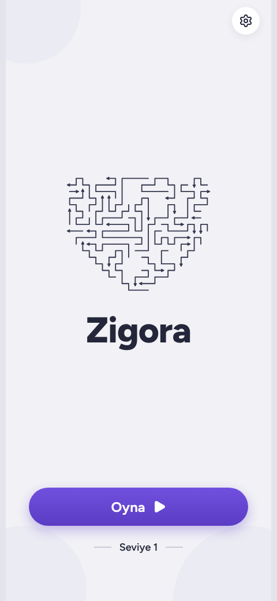
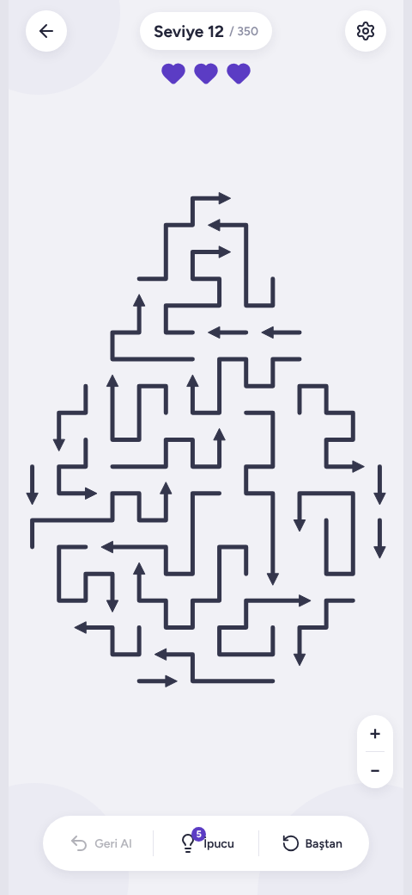

# Zigora

[](https://github.com/helenyildirim/zigora/actions/workflows/ci.yml)
[](LICENSE)

A clean, modern arrow puzzle for Android built with Expo, React Native and TypeScript. Tap the arrows in the right order to clear the board. The interface is in Turkish.

**[Download the Android APK](https://github.com/helenyildirim/zigora/releases/latest)**

<p>
  
  
</p>

## Features

- 350 levels drawn as shapes, and every level is checked to be solvable
- One rule: an arrow with a clear path ahead can leave the board
- Hints, Undo, Restart and a level list
- Pinch to zoom and drag to move on large boards
- Star rating per level
- Hints are shared across levels. Two clean first-time wins in a row earn one, and a rewarded ad refills them
- Progress is saved on the device, with a haptics setting and a progress reset
- The ad uses Google's test ads until a real AdMob ad unit is set up

## How it works

- `src/engine/` holds the rules, the solver, the level generator and the saved levels, with no UI dependencies.
- `src/components/` draws the board, arrows, icons and the result card.
- `src/hooks/` holds the game state and feedback.
- `src/store/` keeps saved progress with Zustand and AsyncStorage.
- `src/app/` has the screens, using Expo Router.
- `scripts/build-levels.ts` generates the levels. `scripts/verify-levels.ts` solves every level and checks that arrows do not overlap and that each head points the right way.

## Run it

```bash
npm install --legacy-peer-deps
npx expo start
```

## Checks

```bash
npm run typecheck
npm run lint
npm test
```

`npm test` runs the level verifier. Use `npm run levels` to regenerate the levels.

## Built with

Expo, React Native, TypeScript, Expo Router, Zustand, Reanimated, Gesture Handler and react-native-svg.
